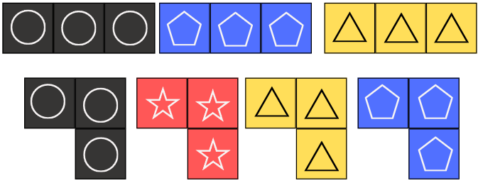
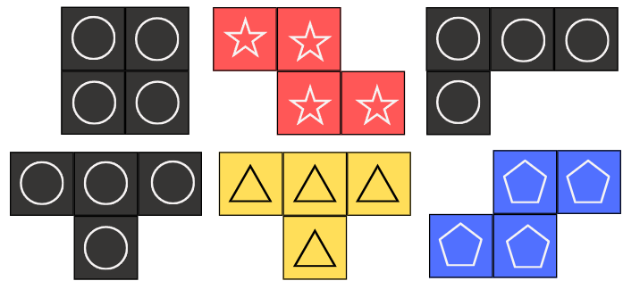

O jogo pode ser confeccionado na escola com papel, cola e papelão, ou cortado em MDF por
quem tiver acesso a corte a laser.

:::{note}
Os arquivos para impressão ainda serão publicados nesta página.
:::

## Componentes

| Componente | Quantidade |
|---|---|
| Galerias (tabuleiros 11 × 11 com paredes internas) | 3 modelos, um tabuleiro por jogador |
| Câmeras | 168 peças em 4 cores (detalhe abaixo) |
| Cartas de obra de arte, com as bases correspondentes | 41 |
| Cartas de contrato público | 8 |
| Cartas de contrato privado | 8 |
| Fichas de ingresso | 7 por jogador |
| Fichas de empréstimo | conjunto comum |

| Câmera | Formatos | Peças |
|---|---|---|
| Monominó | 1 × 1 | 48 (12 por cor) |
| Dominó | 1 × 2 | 48 (12 por cor) |
| Triminó | I e L | 24 (6 por cor) |
| Tetraminó | O, L, T e Z | 24 (6 por cor) |
| Pentaminó | P, X, W, L e T | 24 (6 por cor) |

:::{figure}
:label: fig-tri-tetra

(a) Triminós; (b) tetraminós.
:::

:::{figure} assets/pecas-pentaminos.png
:alt: Pentaminós
:width: 70%

Pentaminós.
:::

## Versão em papel

O material mínimo é papel comum, tesoura e cola. Para durar mais, imprima as peças e as
cartas em papel mais grosso ou cole as folhas em papelão antes de recortar. Os
tabuleiros funcionam bem plastificados.

Mantenha os símbolos dentro das peças (pentágono, estrela, triângulo e círculo) mesmo
numa impressão em preto e branco: são eles que permitem identificar as cores sem
depender da percepção cromática.

## Versão em MDF

Para quem tiver acesso a corte a laser, as peças, as fichas e as bases das obras podem
ser cortadas em MDF. Medidas e arquivos vetoriais serão publicados junto com os arquivos
de impressão.
