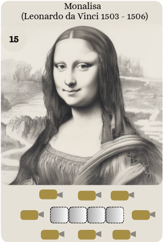
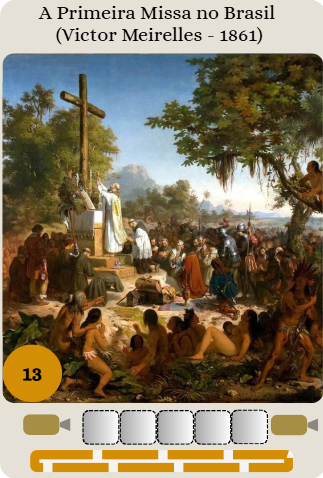

São 41 obras de arte, cada uma com um valor em pontos, um tamanho e um requisito de
vigilância. Para adquirir uma obra, o jogador gasta todas as fichas que lhe restam na
rodada e coloca a base correspondente na galeria, cumprindo o requisito indicado na
parte inferior da carta.

:::{figure}
:label: fig-obras

(a) **Monalisa**: 15 pontos, ocupa 4 casas e precisa ter todo o perímetro vigiado.
(b) **Primeira Missa no Brasil**: 13 pontos, ocupa 5 casas na borda do tabuleiro e precisa
ter vigiados os dois lados menores.
:::

## Bases

Cada obra é representada no tabuleiro por uma base do tamanho indicado na carta.

:::{figure}
:label: fig-bases

Bases da (a) Monalisa e da (b) Primeira Missa no Brasil.
:::

## Curiosidades

No verso das cartas de obra há curiosidades sobre o Problema da Galeria de Arte. Dois
exemplos:

:::{note} Você sabia que o problema foi proposto por Victor Klee em 1973?
Ele apresentou a questão ao matemático Václav Chvátal, que a resolveu em 1975: para
qualquer galeria com $n$ paredes, $\lfloor n/3 \rfloor$ guardas sempre bastam — e às
vezes são mesmo necessários — para vigiar todo o espaço [@chvatal1975combinatorial].
:::

:::{note} Você sabia que o Problema da Galeria de Arte é um clássico da geometria computacional?
Nele, busca-se o número mínimo de guardas necessários para vigiar uma sala com formato
de polígono [@o1987art].
:::
